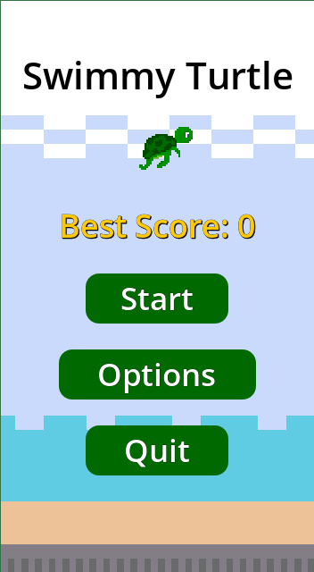

# 🐢 Swimmy Turtle

A casual 2D arcade game made with **Godot 4**, inspired by Flappy Bird. Swim a turtle through the gaps between corals, score a point for every gap, and try to beat your best score.

> **Status: released (January 2026).**
>
> 🎮 **[Play it in your browser, or download the Android version, on itch.io](https://tombitminded.itch.io/swimmy-turtle)**

## Gameplay

- Tap or click to make the turtle swim upward; let go and it sinks.
- Corals come in pairs at random heights: get through the gap to score.
- Touching a coral ends the run.
- Options menu with volume settings.
- On Android, your best score is saved on the device.

## Two versions

The repo holds two builds of the game, both published on itch.io.

| Folder | Published as | What it is |
|---|---|---|
| `html_version/` | Browser version | The first version. One game-manager script handles scrolling, spawning and scoring. |
| `android_version/` | Android APK | A rewrite of the same game, organised by role (`player/`, `object/`, `user_interface/`, `main/`), with a dedicated coral spawner and the best score saved to the device (`user://save.dat`). |

Comparing the two shows how the code changed once I understood Godot better: smaller scripts with one job each, grouped by role, instead of one script doing everything.

## Run it

The easiest way is [itch.io](https://tombitminded.itch.io/swimmy-turtle): play in the browser, or download the APK and install it on an Android phone.

The source here is for reading. The art and audio are kept in a separate private repository, so the project will not open in Godot from this repo alone.

## AI use

- **Code:** the game code (GDScript and scenes) is written by hand. AI assistants were used as a learning aid, to explain Godot concepts and debug ideas, not to generate the game code.
- **Documentation:** this README was drafted with Claude (Anthropic) from the project's code, then reviewed and corrected by me.

## License

Personal project. All rights reserved (see [LICENSE](LICENSE)).
